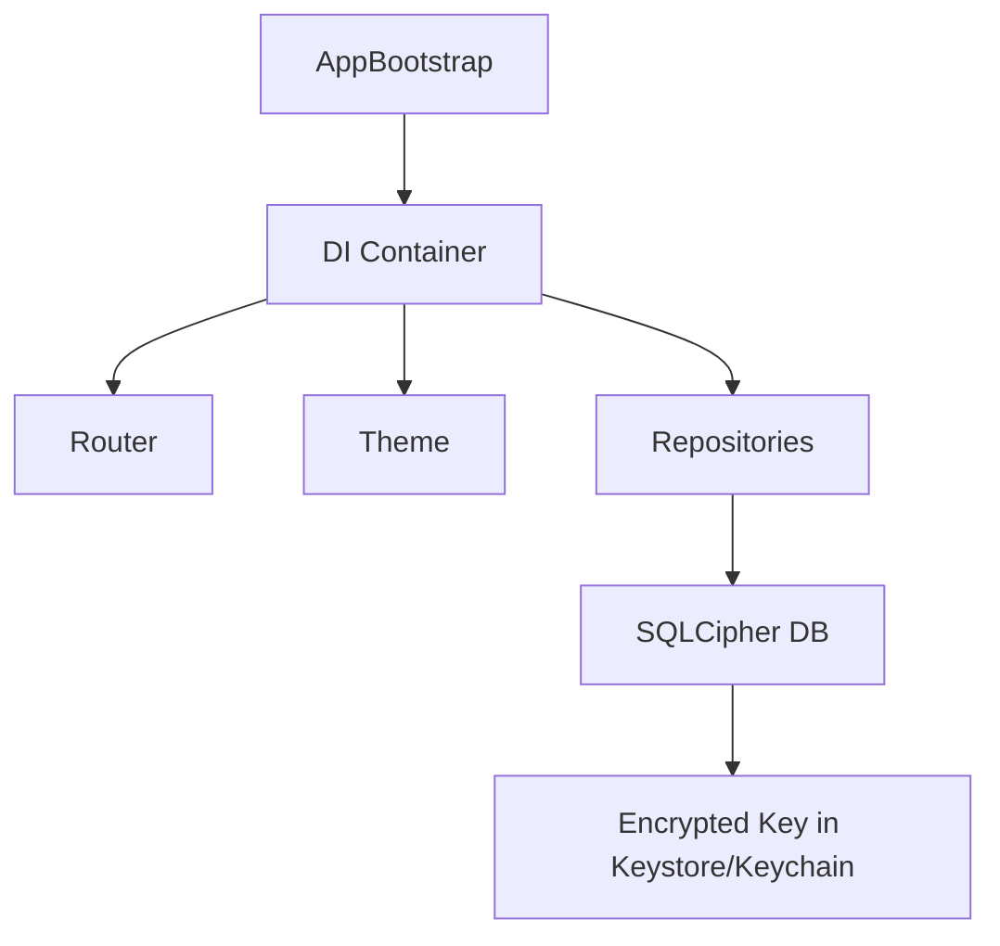
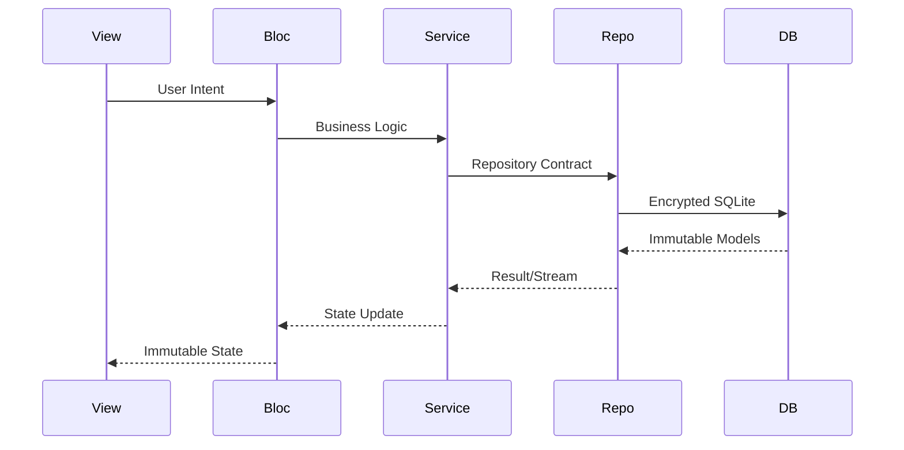
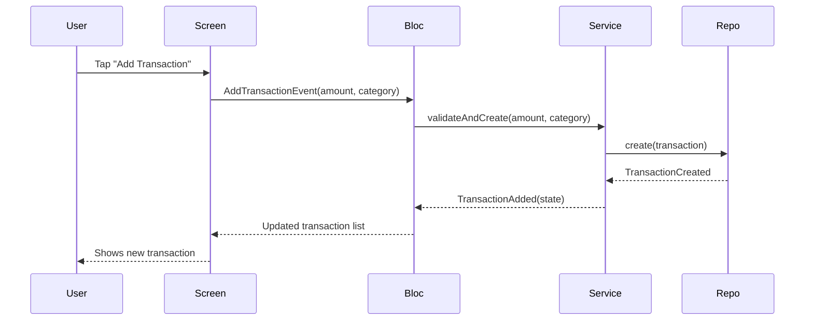

# FinEcho Implementation Plan

> **Status**: Ready for execution  
> **Architecture**: MVVM/BLoC with Repository Pattern  
> **Flavors**: development, staging, production  
> **Localization**: English (default), Arabic  
> **CI/CD**: GitHub Actions + Shorebird OTA  
> **Tracking**: Plane.so via `planecli`  
> **Branching**: Per AGENTS.md — `development` is canonical integration branch; all work on feature branches  
> **Merge Policy**: **PR-only to `development`; no direct merges; user approval required before merge**

---

## ✅ Already Completed (Do Not Execute)

- [x] Flutter environment, tooling, VS Code setup
- [x] Git repository initialized at `/mnt/ALL/Flutter Projects/FinEcho`
- [x] On `development` branch (canonical integration branch)
- [x] Specs finalized in `docs/` (ARCHITECTURE, DEVELOPMENT_ENVIRONMENT, DESIGN_PROMPT, USER_FLOW, PRD, PERFORMANCE_GUIDELINES)

---

## 🔴 MANDATORY RULE: PR-Only Workflow with User Approval

**For EVERY feature branch (including core-infrastructure):**

1. **Create PR** to `development` with comprehensive title/body + diagrams
2. **Watch CI** via `gh run watch` — fix any failures, push fixes to same branch
3. **DO NOT MERGE** — report PR URL and wait for user review
4. **STOP** — do not start next feature until user approves & merges the PR
5. **Only after user merges**: `git checkout development && git pull` then create next feature branch

> This applies to Phase 0 (core-infrastructure) through Phase 7. No exceptions.

---

## Phase 0 — First Feature Branch & Core Dependencies

### 0.1 Create First Feature Branch
```bash
git checkout development
git pull origin development
git checkout -b feature/core-infrastructure
```

### 0.2 Add Dependencies & Configure Tooling
- [ ] Update `pubspec.yaml` with all dependencies
- [ ] Run `flutter pub get`
- [ ] Configure `flutter_launcher_icons` and `flutter_native_splash`
- [ ] Add `very_good_analysis` for linting
- [ ] Run `dart run build_runner build --delete-conflicting-outputs`

**Commit**: `:package: add core dependencies and tooling config`

### 0.3 Create PR & Wait for Approval
```bash
# Push branch
git push origin feature/core-infrastructure

# Create PR with comprehensive body
gh pr create --base development \
  --title "feat: core infrastructure — DI, routing, theming, SQLCipher, repositories" \
  --body "$(cat <<'EOF'
## Summary
Initial core infrastructure for FinEcho: dependency injection, routing, theming, encrypted database layer, and all 10 repository contracts with SQLite implementations.

## Changes
- **DI**: GetIt service locator with all repositories, services, BLoCs registered
- **Routing**: GoRouter with auth guards, deep-link handling, flavor-aware routes
- **Theming**: Light/dark themes per DESIGN.md tokens (Space Grotesk, Inter, color palette)
- **Database**: SQLCipher schema + versioned migrations + secure key storage
- **Repositories**: 10 contracts (Account, Transaction, Budget, Category, Analytics, Speech, SMS, Notification, Settings, Security) with implementations

## Architecture Diagram


## Data Flow


## Testing
- Unit tests for all repository implementations
- Widget tests for core widgets
- Integration test for DB open/migration

## Checklist
- [ ] FAST gate passes (format, analyze, no debugPrint)
- [ ] FULL gate passes (test, build apk/ipa)
- [ ] No secrets in diff
- [ ] Scope limited to core infrastructure only
EOF
)"
```

### 0.4 Watch CI & Fix Failures
```bash
# Get PR number
PR_NUM=$(gh pr view --json number -q .number)

# Watch CI run (blocks until complete)
gh run watch --repo $(gh repo view --json nameWithOwner -q .nameWithOwner) \
  --run-id $(gh api repos/$(gh repo view --json nameWithOwner -q .nameWithOwner)/pulls/$PR_NUM/runs --jq '.workflow_runs[0].id')

# If failures: fix, commit with :bug:, push, watch again
# REPEAT until CI green
```

### 0.5 Report & Wait
```
✅ PR created: https://github.com/.../pull/X
✅ CI passing
⏳ Waiting for your review and merge...
```
**STOP HERE** — do not continue until user merges PR.

---

## Phase 1 — Core Infrastructure (Continued on Same Branch)

After user merges `feature/core-infrastructure`:
```bash
git checkout development
git pull origin development
# Continue on SAME branch or create sub-branches for logical units?
# Per AGENTS.md: keep feature branch intact; add commits to same branch
```

### 1.1–1.5 Implementation (Add Commits to Same Branch)
Each logical unit = 1 commit with emoji prefix:
- `:sparkles: add app bootstrap and DI`
- `:sparkles: add routing and theming`
- `:sparkles: add encrypted SQLCipher database layer`
- `:sparkles: add AccountRepository contract and implementation`
- ... (per repository, per widget group)

### After Each Logical Unit (Optional Intermediate PRs)
If a unit is large enough to warrant separate review:
```bash
# Push commits to same branch
git push origin feature/core-infrastructure
# Create/update PR (same PR number if exists)
gh pr edit --body "$(updated_body_with_new_diagrams)"
# Watch CI again
```

### Final PR for Core Infrastructure
When all 1.1–1.5 complete:
- Update PR body with complete architecture diagram
- Watch CI → fix → report → **wait for user merge**

---

## Phase 2 — Feature Implementation (One Branch Per Feature)

### Branching Protocol (MANDATORY)
```bash
# AFTER user merges previous feature to development:
git checkout development
git pull origin development
git checkout -b feature/{kebab-case-name}

# Implement feature
# Commit per logical unit with emoji prefix
# Push to branch
git push origin feature/{name}

# Create PR with comprehensive body
gh pr create --base development \
  --title "feat: {feature name} — {one-line summary}" \
  --body "$(cat <<'EOF'
## Summary
{2-3 sentences: what this feature does, user-facing value}

## Changes
- {Bullet list of changes with file references}

## Architecture Diagram
```mermaid
graph TD
    {Feature-specific diagram: View → Bloc → Service → Repo → DB}
```

## User Flow


## Screenshots (Placeholders — Replace per Feature)
| Screen | Light | Dark |
|--------|-------|------|
| {Screen Name} | `` | `` |
| *Example: Home Ledger* | `` | `` |

## Testing
- Unit tests: {list}
- Widget tests: {list}
- Integration tests: {list}

## Checklist
- [ ] FAST gate passes
- [ ] FULL gate passes
- [ ] No secrets in diff
- [ ] Scope limited to {feature} domain only
- [ ] README placeholders added (screenshots/videos)
EOF
)"
```

### Watch CI → Fix → Report → **Wait for User Merge**
```bash
gh run watch ...  # same as above
# If failures: fix, commit :bug:, push, watch again
# When green: report PR URL, STOP, wait for user approval
```

### Feature Order
1. `feature/onboarding`
2. `feature/security`
3. `feature/transaction`
4. `feature/account`
5. `feature/budget`
6. `feature/analytics`
7. `feature/speech-to-text`
7. `feature/sms-ingestion`
8. `feature/notifications`
9. `feature/settings`

**Each feature = full PR cycle with user approval before next branch created.**

---

## Phase 3 — Cross-Cutting Concerns (Parallel PRs)

Can run in parallel after `feature/settings` merged:

| Branch | PR Title |
|--------|----------|
| `feature/localization` | `feat: i18n — English/Arabic with RTL support` |
| `feature/animations` | `feat: animations — thinking dots, waveform, border beam, search explode` |
| `feature/splash-and-icons` | `feat: native splash (GIF/Lottie) + adaptive app icons` |

**Each = separate PR, separate CI watch, separate user approval.**

---

## Phase 4 — Shorebird (`feature/shorebird`)

Same PR workflow. Include Shorebird config diagrams in PR body.

---

## Phase 5 — CI/CD Workflows (`.github/workflows/`)

Same PR workflow. Include workflow diagrams.

---

## Phase 6 — Plane Integration (`feature/plane-integration`)

Same PR workflow.

---

## Phase 7 — Verification & Delivery (Per Feature)

### 7.1 Verification Subagent Loop (Before PR Creation)
**Run BEFORE creating PR for each feature:**

1. **Subagent 1 (QA)**: `qa-post-implementation` skill
   - Verification, code review, security audit, branch status
   - Fix ALL findings → re-run → **ZERO findings required**

2. **Subagent 2 (Coverage)**: `test-coverage-analysis` skill
   - Map changed source to tests
   - Implement missing tests → re-run → **ZERO findings required**

3. **Spec Sync**: `filling-gaps` to sync specs with implementation

4. **README Update**: Add feature section with screenshot/video placeholders
   - Commit: `:memo: update README with {feature} screenshots and demo videos`

### 7.2 PR Creation (Parent Agent)
```bash
# Only after BOTH subagents report ZERO findings
gh pr create --base development \
  --title "feat: {feature name}" \
  --body "$(cat <<'EOF'
  {Comprehensive body with diagrams, flowcharts, screenshots placeholders, test summary}
  EOF
)"
```

### 7.3 CI Watch & Fix
```bash
# Watch CI, fix failures, push fixes to same branch
# DO NOT MERGE
# Report: "PR #X ready for review: https://github.com/.../pull/X"
```

### 7.4 User Review & Merge
```
⏳ Waiting for your review...
✅ You approve & merge → I continue to next feature
```

### 7.5 Post-Merge (After User Merges)
```bash
git checkout development
git pull origin development
# Plane update
planecli work-item update <id> --state "Done"
# Then create next feature branch
```

---

## Branch & Commit Discipline (AGENTS.md Compliance)

| Rule | Enforcement |
|------|-------------|
| **No direct commits to `development`** | All work on `feature/` branches only |
| **Emoji commits only** | Use `emoji-commit` skill for every commit |
| **FAST gate per commit** | `dart format`, `flutter analyze`, no `debugPrint` |
| **No `git add -A`** | Stage by explicit path: `git add lib/features/...` |
| **Scope audit per commit** | `git diff --staged` — only current feature's domain |
| **Leakage = STOP** | Conflict touching another feature's domain → escalate |
| **Never delete branches** | Merged branches stay for audit/rollback |
| **Worktree for parallel** | Only when 2+ features touch overlapping files |

### Commit Message Format
```
:sparkles: add transaction list view with pagination
:bug: fix transfer balance calculation for credit cards
:lipstick: add animated search field with explode effect
:white_check_mark: add unit tests for TransactionBloc
:recycle: refactor Money class to use sealed class
:bookmark: release v1.0.0
:memo: update README with onboarding screenshots and demo videos
```

---

## CI Watching Commands (Reference)

```bash
# Get latest run ID for a PR
gh api repos/{owner}/{repo}/pulls/{pr_number}/runs --jq '.workflow_runs[0].id'

# Watch specific run
gh run watch --run-id {run_id} --repo {owner}/{repo}

# View run logs on failure
gh run view --run-id {run_id} --log-failed

# Re-run failed jobs
gh run rerun --run-id {run_id} --repo {owner}/{repo}
```

---

## Risk Mitigation

| Risk | Mitigation |
|------|------------|
| SQLCipher key loss | Store key only in Keystore/Keychain; test key rotation |
| Android SMS permission denial | Graceful degradation; no-op iOS adapter |
| Shorebird patch failure | Fallback to full store release; test patch apply/restart |
| Arabic RTL layout breaks | Widget tests with `Directionality.rtl`; manual QA on device |
| Performance on low-end | Profile with `flutter run --profile`; use `const` constructors, lazy lists |
| CI flakiness | Re-run failed jobs; investigate root cause before pushing fix |

---

## Success Criteria (Project Level)

- [ ] All 10 features + cross-cutting implemented via PRs
- [ ] Each PR approved & merged by user
- [ ] FULL gate green on `development` after all merges
- [ ] Shorebird release published for production
- [ ] All Plane work items in Done state
- [ ] Specs synced with final implementation
- [ ] No secrets, debug prints, TODOs in code
- [ ] Release tagged `v1.0.0` on `master`

---

## Subagent Dispatch Plan

| Phase | Subagent | Skill | Trigger |
|-------|----------|-------|---------|
| 0-1 | Senior Developer | — | Core infrastructure (on `feature/core-infrastructure`) |
| 2.x | Senior Developer | `test-driven-development` | Per feature implementation |
| 2.x | QA Subagent | `qa-post-implementation` | Post-impl verification (before PR) |
| 2.x | Coverage Subagent | `test-coverage-analysis` | Test mapping & missing tests (before PR) |
| 3 | Senior Developer | — | Localization, animations, splash, icons (parallel PRs) |
| 4 | Senior Developer | — | Shorebird setup |
| 5 | Senior Developer | — | CI/CD pipelines |
| 6 | General | `planecli` | Plane automation |
| 7 | Orchestrator | `feature-summary`, `merge-message` | PR body generation (but NO merge) |

---

## Execution Flow (PR-Gated)

```
feature/core-infrastructure
  → PR → CI watch → fix → report → USER MERGES → continue
       ↓
feature/onboarding
  → PR → CI watch → fix → report → USER MERGES → continue
       ↓
feature/security
  → PR → CI watch → fix → report → USER MERGES → continue
       ↓
feature/transaction
  → PR → CI watch → fix → report → USER MERGES → continue
       ↓
feature/account
  → PR → CI watch → fix → report → USER MERGES → continue
       ↓
feature/budget
  → PR → CI watch → fix → report → USER MERGES → continue
       ↓
feature/analytics
  → PR → CI watch → fix → report → USER MERGES → continue
       ↓
feature/speech-to-text
  → PR → CI watch → fix → report → USER MERGES → continue
       ↓
feature/sms-ingestion
  → PR → CI watch → fix → report → USER MERGES → continue
       ↓
feature/notifications
  → PR → CI watch → fix → report → USER MERGES → continue
       ↓
feature/settings
  → PR → CI watch → fix → report → USER MERGES → continue
       ↓
Parallel PRs: localization, animations, splash+icons
       ↓
feature/shorebird
       ↓
feature/plane-integration
       ↓
CI/CD workflows PR
       ↓
Final verification → tag v1.0.0 on master
```

**Each step = PR created → CI green → USER APPROVES & MERGES → I continue.**

---

**Ready to start. First action: create `feature/core-infrastructure` branch, add dependencies, push, create PR, watch CI, report, and wait for your merge.**
